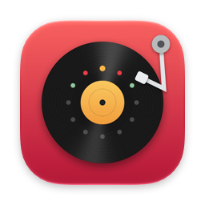

<p align="center">
    <a href="https://lowtechguys.com/muskey"></a>
    <h1 align="center"><code style="text-shadow: 0px 3px 10px rgba(8, 0, 6, 0.35); font-size: 3rem; font-family: ui-monospace, Menlo, monospace; font-weight: 800; background: transparent; color: #b8243a; padding: 0.2rem 0.2rem; border-radius: 6px">Muskey</code></h1>
    <h4 align="center">Find the key of any song</h4>
    <h6 align="center">Change it with one click</h6>
</p>

<p align="center">
    <a href="https://files.lowtechguys.com/releases/Muskey.dmg"></a>
</p>
<p align="center">
    <small>Free and open source · macOS 26 Tahoe or later on Apple silicon</small>
</p>

---

## Key Features

- Detect the key of the playing song
    > Press <kbd>Control</kbd> <kbd>Command</kbd> <kbd>M</kbd> while a song plays to see its key after a few seconds.

- Change the song key on the fly
    > Click any key or press an <kbd>A–G</kbd> letter on the keyboard to pitch the song in that key without changing the tempo.

- Instruments and vocals
    > Mute the drums, the bass or the vocals of any song while it plays. Hold <kbd>Option</kbd> and click the guitar, piano or trumpet to hear only that part and practise it.

- Lyrics and karaoke
    > Click **Lyrics** to see the words line by line as the song plays. Click **Karaoke** to view them full screen and mute the vocals so you can sing along.

- Card layout
    > Switch to the **Card style** to view the keys on the circle of fifths.

- Songs from files and links
    > Drop an audio or video file on Muskey, or a link to a song on YouTube or any other site that [yt-dlp](https://github.com/yt-dlp/yt-dlp) supports, and Muskey plays it with everything above.

## Build from source

```sh
brew install eigen
make install
```

On the first build, Essentia, Rubber Band and Sparkle are downloaded into `vendor/` and compiled, which takes a few minutes.

Builds are signed with a Developer ID, which keeps the System Audio Recording permission across rebuilds. To sign with your own, run `make install IDENTITY="Developer ID Application: Your Name (TEAMID)"`.

Read [DEVELOPMENT.md](DEVELOPMENT.md) to learn how Muskey works and which flags it takes for testing.

## Licence

Muskey is free software under the [GNU Affero General Public License v3.0](LICENSE). It includes code from these projects:

- [Essentia](https://github.com/MTG/essentia): AGPL-3.0, linked statically
- [Rubber Band](https://github.com/breakfastquay/rubberband): GPL-2.0 or later
- [PitchTap](https://github.com/gkudva96/pitchtap): GPL-3.0, the starting point of the pitch change
- [Sparkle](https://github.com/sparkle-project/Sparkle): MIT
- [whisper.cpp](https://github.com/ggml-org/whisper.cpp): MIT, linked statically

The separation models and the Whisper model aren't part of the app. They are downloaded in Settings.
