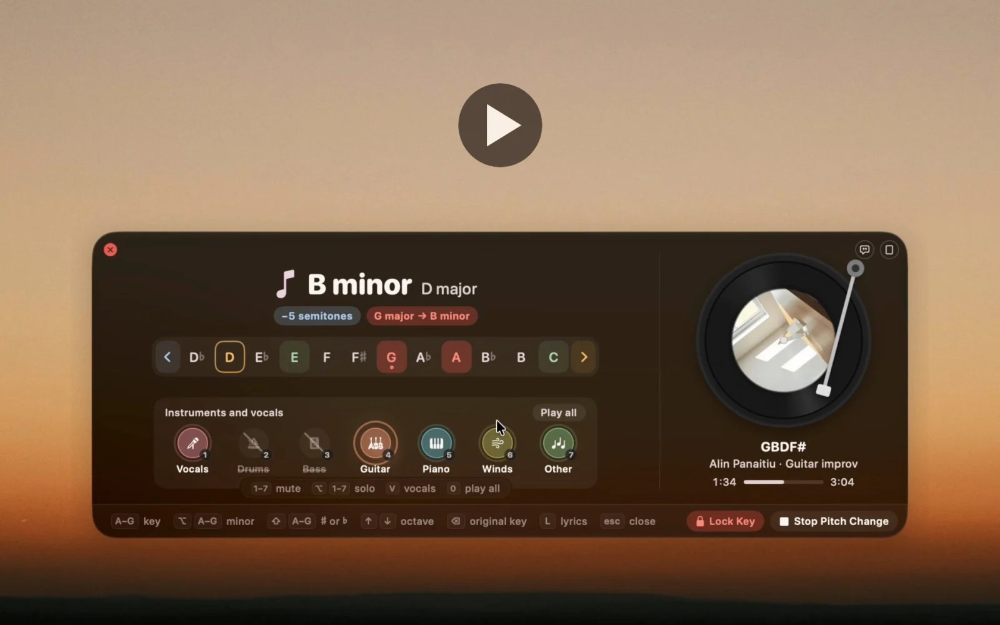

<p align="center">
    <a href="https://lowtechguys.com/muskey"></a>
    <h1 align="center"><code style="text-shadow: 0px 3px 10px rgba(8, 0, 6, 0.35); font-size: 3rem; font-family: ui-monospace, Menlo, monospace; font-weight: 800; background: transparent; color: #b8243a; padding: 0.2rem 0.2rem; border-radius: 6px">Muskey</code></h1>
    <h4 align="center">Find the key of any song</h4>
    <h6 align="center">Change it with one click</h6>
</p>

<p align="center">
    <a href="https://files.lowtechguys.com/releases/Muskey.dmg"></a>
</p>
<p align="center">
    <small>Free and open source · macOS 26 Tahoe or later on Apple silicon</small>
</p>

---

## Demo

<p align="center">
    <a href="https://lowtechguys.com/static/video/muskey-demo-h264.mp4"></a>
</p>
<p align="center">
    <sub>Song: Cartoon, Jéja - On &amp; On (feat. Daniel Levi) [NCS Release]. Music provided by NoCopyrightSounds. Free Download/Stream: <a href="https://ncs.io/onandon">ncs.io/onandon</a></sub>
</p>

## Key Features

<p align="center">
    
</p>

- Songs from files and links
    > Drop an audio or video file on Muskey, or a link to a song on YouTube or any other site that [yt-dlp](https://github.com/yt-dlp/yt-dlp) supports, and Muskey plays it with everything above.

## Build from source

```sh
brew install eigen lame
make install
```

On the first build, Essentia, Rubber Band and Sparkle are downloaded into `vendor/` and compiled, which takes a few minutes.

Builds are signed with a Developer ID, which keeps the System Audio Recording permission across rebuilds. To sign with your own, run `make install IDENTITY="Developer ID Application: Your Name (TEAMID)"`.

Read [DEVELOPMENT.md](DEVELOPMENT.md) to learn how Muskey works and which flags it takes for testing.

## Licence

Muskey is free software under the [GNU Affero General Public License v3.0](LICENSE). It includes code from these projects:

- [Essentia](https://github.com/MTG/essentia): AGPL-3.0, linked statically
- [Rubber Band](https://github.com/breakfastquay/rubberband): GPL-2.0 or later
- [PitchTap](https://github.com/gkudva96/pitchtap): GPL-3.0, the starting point of the pitch change
- [Sparkle](https://github.com/sparkle-project/Sparkle): MIT
- [whisper.cpp](https://github.com/ggml-org/whisper.cpp): MIT, linked statically
- [Dettato](https://github.com/kobimusic/dettato): Apache-2.0, the transcriber of notes, ported to Swift and Core ML. Its notice reads: "Dettato, Copyright 2026 KobiMusic. This product includes software and model weights developed by KobiMusic."
- [Omnilingual ASR](https://github.com/facebookresearch/omnilingual-asr): Apache-2.0, the model that reads sung words for timing lyrics, converted to Core ML with 8-bit weights. Copyright 2025 Meta Platforms, Inc. and affiliates.

The separation models, the transcription model, the lyrics timing model and the Whisper model aren't part of the app. They are downloaded in Settings.
